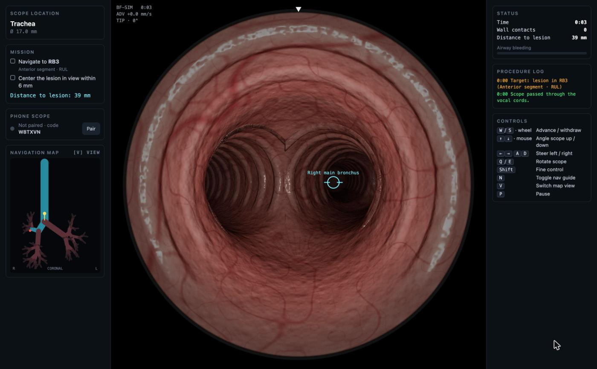
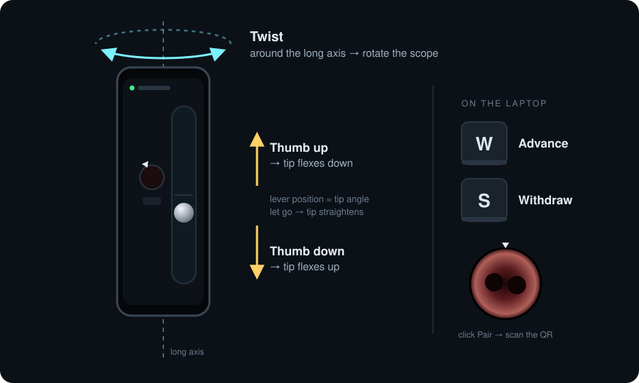

# Bronchoscopy Simulator

**▶ Play: https://mcclane.github.io/bronchoscopy/**

## Use your phone as the scope

Click **Pair** in the simulator and scan the QR code with your phone.

For local development: `npm run dev`, then open http://localhost:8080.
